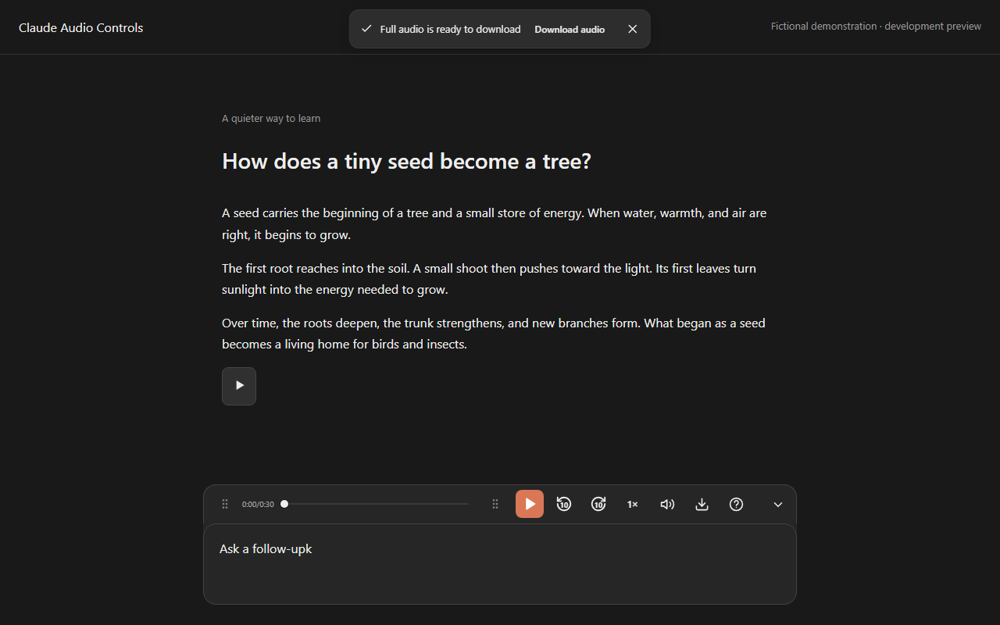

# Claude Audio Controls

Native Claude Read aloud, with pause, buffered seeking, playback speed, volume and audio downloads. An independent Infoxica project, styled to follow Claude's current interface.

**0.1.0 is a development preview.** Production publication is blocked by the live acceptance matrix in [docs/ACCEPTANCE.md](docs/ACCEPTANCE.md). This repository contains the browser extension, a generated Tampermonkey userscript, and the localized companion website. Store listings are not available yet.



## Develop and install

Use Bun 1.4.3 and a current Chromium browser with MediaSource, Opus playback and WebCodecs audio encoding. Chrome/Edge desktop and Edge Android are the target platforms; physical device acceptance is tracked separately.

```sh
bun install --frozen-lockfile
bun run build
```

In `chrome://extensions` or `edge://extensions`, enable Developer mode, select **Load unpacked**, and select the generated `dist` directory. Reload Claude, then choose **Read aloud** on a written reply. The player appears above the composer. A browser restart or extension reload requires reloading existing Claude tabs.

For Tampermonkey, install `userscript/claude-audio-controls.user.js` and enable userscript execution in your browser. The userscript is generated from the same player and CSS; its settings are available in the on-page player. Use either the extension or userscript in a tab. A shared guard prevents duplicate players.

Defaults: 1× speed, full volume, 10-second seeking, automatic language, composer docking. Controls include 0.5×–3× speed, hold-to-seek, mute, completed-reply downloads, layout presets and keyboard shortcuts. Playback shortcuts are suppressed in editable fields. Extension toolbar and browser shortcut assignment are extension-only features.

## Audio architecture

Claude initiates speech generation with its own authentication, voice and pace settings. A document-start MAIN-world adapter observes only the verified native reply WebSocket endpoint after a Read aloud action. It pauses Claude before playing the captured stream through an owned HTML audio element. It does not read conversation text or request a speech service.

- Native Opus packets are packaged as streaming WebM. Native PCM is encoded locally to Opus for MediaSource playback.
- Seeking is bounded by received audio; final duration and downloads are unavailable until successful completion.
- Downloads are finalized WebM/Opus for native Opus and WAV for native PCM.
- One active reply per tab; navigation, replacement, errors and disposal invalidate pending work and revoke object URLs.
- Extension-owned audio has a conservative 64 MiB retention budget. Browser decoder and Claude's native buffers are controlled by their respective owners.
- Unsupported capabilities or protocol changes restore the native button and show a recovery message.

See [docs/ARCHITECTURE.md](docs/ARCHITECTURE.md). Live voice conversations and microphone controls are outside this release.

## Validate and package

```sh
bun run typecheck
bun run test
bunx playwright install chromium
bun run test:browser
bun run build:site
bun run typecheck:feedback
bun run package
```

Browser tests exercise actual MediaSource/WebCodecs, independently decode generated files, compare extension/userscript behavior and validate all 67 interface locales. Demo screenshots use only fictional content. Runtime and release evidence are recorded in [docs/ACCEPTANCE.md](docs/ACCEPTANCE.md).

`bun run release:check` intentionally fails until the version-specific acceptance gates and new store identifiers are complete. Creating a development ZIP does not publish a release.

## Website and feedback

The companion website targets https://claude-audio-controls.infoxica.com/ and includes 67 localized homepages, installation guides, usage guides, userscript instructions, glossary and privacy information. Static HTML, Markdown alternatives, canonical/hreflang metadata and sitemaps are generated from source.

Review the [development staging site](https://claude-audio-controls-staging.anand224patel.workers.dev/). Production has no public endpoint yet.

The feedback Worker uses separate Claude staging and production D1 databases and Turnstile widgets. See [docs/DEPLOYMENT.md](docs/DEPLOYMENT.md). The extension has no usage telemetry. Website analytics load only after consent and remain disabled when no dedicated measurement ID is configured. Feedback and uninstall forms have no analytics.

## License and provenance

Project code is MIT licensed. UI, layout, localization and support foundations were selectively ported from [Infoxica's ChatGPT Audio Controls](https://github.com/infoxica/chatgpt-audio-controls), version 1.4.1, source commit `c7c39f1745b32f3694c35e6a9c5f1fa06039b74a`. This project has independent history and namespaces; its audio backend was written for Claude.

Mediabunny remains MPL-2.0. Dependency notices and source pointers are in [THIRD_PARTY_NOTICES.md](THIRD_PARTY_NOTICES.md) and accompany the extension ZIP. Claude and Anthropic are trademarks of Anthropic. This project is not affiliated with or endorsed by Anthropic.
