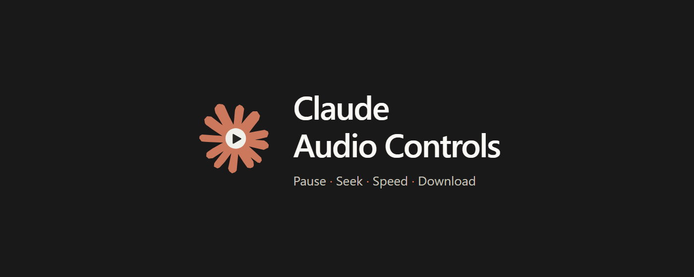
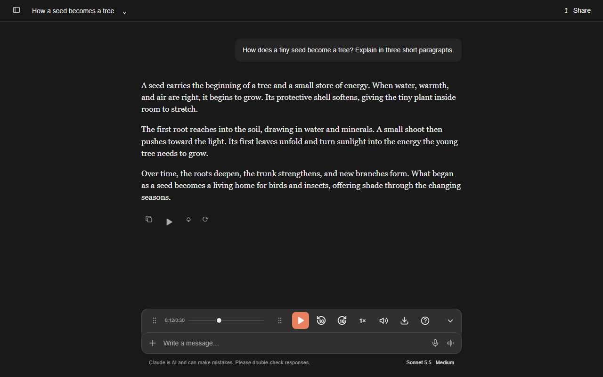
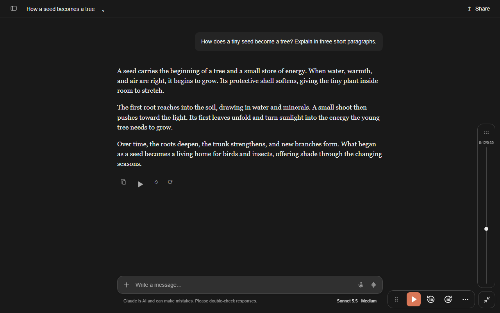
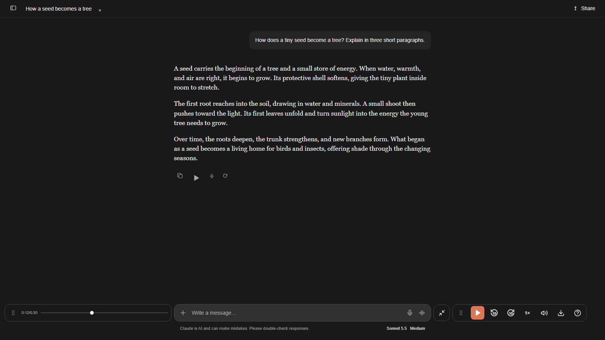
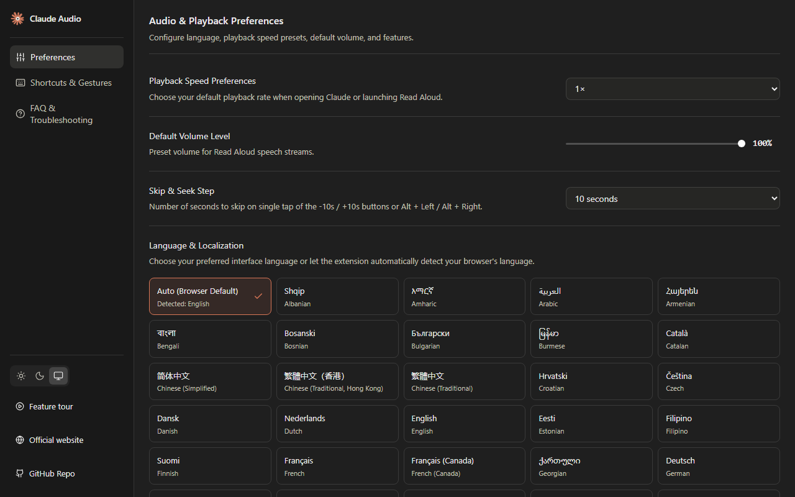

<div align="center">

# 🎙️ Claude Audio Controls & Read Aloud

**Playback controls that make Claude Read Aloud usable.**<br />
*Play, pause, seek, change speed, adjust volume, download audio, and keep your place while listening.*

<p align="center">
  <a href="https://chromewebstore.google.com/detail/phpfodemdjccejlpchbeeehjdgaldldi/">
    
  </a>
  &nbsp;&nbsp;&nbsp;&nbsp;
  <a href="https://microsoftedge.microsoft.com/addons/detail/claude-audio-controls-/gabdlfkfofnclhnpcmdfikijmmckpcee">
    
  </a>
</p>

[](CHANGELOG.md)
[](https://chromewebstore.google.com/detail/phpfodemdjccejlpchbeeehjdgaldldi/)
[](https://microsoftedge.microsoft.com/addons/detail/claude-audio-controls-/gabdlfkfofnclhnpcmdfikijmmckpcee)
[](userscript/claude-audio-controls.user.js)
[](LICENSE)
[](https://agent-ready.dev)

[Changelog](CHANGELOG.md) • [Official website](https://claude-audio-controls.infoxica.com/) • [Why I Created This](#why-i-created-this) • [Features](#features) • [Video & Screenshots](#video--screenshots) • [Languages](#-multi-language--internationalization-i18n) • [Installation](#installation) • [Tampermonkey Guide](#tampermonkey-guide-no-extension-required) • [Shortcuts](#keyboard-shortcuts--gestures) • [FAQ](#faq) • [Privacy](#privacy-policy)

<br />



</div>

---

<a id="why-i-created-this"></a>

## 🎧 Why I Created This

In the AI age, a simple question can turn into a kilometre-long answer before you have finished your coffee. Claude's native Read Aloud button starts playback; longer answers benefit from pause, resume, and seeking controls.

Pause halfway through because a call comes in? Suddenly you are choosing between real life and the remaining half of an AI-generated epic. That felt needlessly frustrating.

This extension adds play/pause, seeking, speed, volume, and download controls right where the conversation happens.

> Claude Audio Controls is an independent project and is not affiliated with, endorsed by, or sponsored by Anthropic. Claude is a trademark of Anthropic.

---

## Video & Screenshots

See playback, seeking, speed, downloads and docking in action.

[](https://claude-audio-controls.infoxica.com/#layouts)

[▶ Explore the interactive layout gallery](https://claude-audio-controls.infoxica.com/#layouts) · [Read the user guide](https://claude-audio-controls.infoxica.com/guide/)

### Corner layout



### Original layout



<a id="features"></a>

## ✨ Features

### 🎛️ Integrated Floating Player

- **Seeker & Scrubbing**: Drag the progress bar to revisit received audio, with playback position and buffering shown as the reply arrives.
- **Hold to Accelerate**: Hold down the ◀10s or 10s▶ buttons to smoothly scrub through long audio with dynamic acceleration (up to 50× seek rate).
- **Speed Presets**: Instant switching between `0.5×`, `0.75×`, `1.0×`, `1.25×`, `1.5×`, `1.75×`, `2.0×`, `2.5×`, and `3.0×`.
- **Hover-Scroll Volume**: Hover over the speaker icon and scroll your mouse wheel to adjust volume effortlessly in 5% increments.
- **Audio Download**: Save completed replies as WAV or WebM/Opus. Choose WAV for Windows Media Player compatibility.
- **Responsive Layout**: Keeps the player usable on narrow laptop screens.
- **Compact Toggle**: Collapse or expand the player with a compact control that fits Claude’s composer styling.

### ⚛️ Extension Popup & Dashboard

<div align="center">
  
</div>

- **Popup**: Speed presets, volume, shortcuts, and player layout settings.
- **Settings Dashboard**: Customize default speed, volume, and seek step; view shortcuts and troubleshooting guidance.
- **System, Light, or Dark** appearance for the popup, settings dashboard, and feedback form. System follows your device preference; your choice is remembered.
- **Feature Tour**: A short, skippable introduction to the main controls, available again from settings.

### 🌐 Multi-Language & Internationalization (i18n)

- **Automatic Browser Language Detection**: Automatically adapts to your browser language out of the box.
- **Customizable in Settings**: Switch your preferred interface language anytime from the Dashboard.
- **Supported interface languages (67)**:
  - **Albanian** — Shqip (`sq`)
  - **Amharic** — አማርኛ (`am`)
  - **Arabic** — العربية (`ar`)
  - **Armenian** — Հայերեն (`hy`)
  - **Bengali** — বাংলা (`bn`)
  - **Bosnian** — Bosanski (`bs`)
  - **Bulgarian** — Български (`bg`)
  - **Burmese** — မြန်မာ (`my`)
  - **Catalan** — Català (`ca`)
  - **Chinese (Simplified)** — 简体中文 (`zh-CN`)
  - **Chinese (Traditional, Hong Kong)** — 繁體中文（香港） (`zh-HK`)
  - **Chinese (Traditional)** — 繁體中文 (`zh-TW`)
  - **Croatian** — Hrvatski (`hr`)
  - **Czech** — Čeština (`cs`)
  - **Danish** — Dansk (`da`)
  - **Dutch** — Nederlands (`nl`)
  - **English** — English (`en`)
  - **Estonian** — Eesti (`et`)
  - **Filipino** — Filipino (`fil`)
  - **Finnish** — Suomi (`fi`)
  - **French** — Français (`fr`)
  - **French (Canada)** — Français (Canada) (`fr-CA`)
  - **Georgian** — ქართული (`ka`)
  - **German** — Deutsch (`de`)
  - **Greek** — Ελληνικά (`el`)
  - **Gujarati** — ગુજરાતી (`gu`)
  - **Hebrew** — עברית (`he`)
  - **Hindi** — हिन्दी (`hi`)
  - **Hindi (Latin)** — Hindi (Latin) (`hi-Latn`)
  - **Hungarian** — Magyar (`hu`)
  - **Icelandic** — Íslenska (`is`)
  - **Indonesian** — Bahasa Indonesia (`id`)
  - **Italian** — Italiano (`it`)
  - **Japanese** — 日本語 (`ja`)
  - **Kannada** — ಕನ್ನಡ (`kn`)
  - **Kazakh** — Қазақ тілі (`kk`)
  - **Korean** — 한국어 (`ko`)
  - **Latvian** — Latviešu (`lv`)
  - **Lithuanian** — Lietuvių (`lt`)
  - **Macedonian** — Македонски (`mk`)
  - **Malay** — Bahasa Melayu (`ms`)
  - **Malayalam** — മലയാളം (`ml`)
  - **Marathi** — मराठी (`mr`)
  - **Mongolian** — Монгол (`mn`)
  - **Norwegian Bokmål** — Norsk bokmål (`nb`)
  - **Persian** — فارسی (`fa`)
  - **Polish** — Polski (`pl`)
  - **Portuguese (Brazil)** — Português (Brasil) (`pt-BR`)
  - **Portuguese (Portugal)** — Português (Portugal) (`pt-PT`)
  - **Punjabi** — ਪੰਜਾਬੀ (`pa`)
  - **Romanian** — Română (`ro`)
  - **Russian** — Русский (`ru`)
  - **Serbian** — Српски (`sr`)
  - **Slovak** — Slovenčina (`sk`)
  - **Slovenian** — Slovenščina (`sl`)
  - **Somali** — Soomaali (`so`)
  - **Spanish** — Español (`es`)
  - **Spanish (Latin America)** — Español (Latinoamérica) (`es-419`)
  - **Swahili** — Kiswahili (`sw`)
  - **Swedish** — Svenska (`sv`)
  - **Tamil** — தமிழ் (`ta`)
  - **Telugu** — తెలుగు (`te`)
  - **Thai** — ไทย (`th`)
  - **Turkish** — Türkçe (`tr`)
  - **Ukrainian** — Українська (`uk`)
  - **Urdu** — اردو (`ur`)
  - **Vietnamese** — Tiếng Việt (`vi`)


---

<a id="installation"></a>

## 🚀 Installation

### Option 1: Official Browser Stores (Recommended)

Get automatic updates and seamless one-click installation from your browser's official store:

| Store | Supported Browsers | Install Badge | Direct Link |
| :--- | :--- | :---: | :--- |
| **Chrome Web Store** | Google Chrome, Brave, Arc, Opera, Vivaldi | <a href="https://chromewebstore.google.com/detail/phpfodemdjccejlpchbeeehjdgaldldi/"></a> | [Install from Chrome Web Store](https://chromewebstore.google.com/detail/phpfodemdjccejlpchbeeehjdgaldldi/) |
| **Microsoft Edge Add-ons** | Microsoft Edge | <a href="https://microsoftedge.microsoft.com/addons/detail/claude-audio-controls-/gabdlfkfofnclhnpcmdfikijmmckpcee"></a> | [Install from Microsoft Edge Add-ons](https://microsoftedge.microsoft.com/addons/detail/claude-audio-controls-/gabdlfkfofnclhnpcmdfikijmmckpcee) |

---

### Option 2: Manual Installation (Developer Mode / Unpacked)

#### Method A: Load from Source

1. Clone or download this repository:
   ```bash
   git clone https://github.com/infoxica/claude-audio-controls.git
   cd claude-audio-controls
   ```
2. Install dependencies and build with Bun:
   ```bash
   bun install
   bun run build
   ```
3. Open your browser extension settings:
   - **Chrome**: `chrome://extensions/`
   - **Brave**: `brave://extensions/`
   - **Edge**: `edge://extensions/`
4. Turn on **Developer mode** (toggle in the top-right corner).
5. Click **Load unpacked** and select the `dist/` directory.
6. Open [claude.ai](https://claude.ai) and start **Read aloud** on a completed reply to use the player!

#### Method B: Install from Release ZIP

1. Download the latest `claude-audio-controls-v*.zip` from [Releases](https://github.com/infoxica/claude-audio-controls/releases).
2. Unzip to a folder on your computer.
3. In `chrome://extensions/`, enable **Developer mode**, click **Load unpacked**, and select the unzipped folder.

---

<a id="tampermonkey-guide-no-extension-required"></a>

## 🐒 Tampermonkey Guide (No Extension Required)

If you prefer using a userscript manager (on Chrome or Edge):

1. Install [Tampermonkey](https://www.tampermonkey.net/).
2. Click the link below to open the raw userscript:
   👉 **[Install Claude Audio Controls Userscript](https://raw.githubusercontent.com/infoxica/claude-audio-controls/main/userscript/claude-audio-controls.user.js)**
3. Tampermonkey will open and ask you to click **Install**.
4. Visit [https://claude.ai](https://claude.ai) and start **Read aloud** on a completed reply.

> [!TIP]
> **Automatic Updates**: The userscript includes `@updateURL` and `@downloadURL` pointing to GitHub. Tampermonkey will automatically check for updates and keep your script current.

---

<a id="keyboard-shortcuts--gestures"></a>

## ⌨️ Keyboard Shortcuts & Gestures

| Shortcut | Action | Description |
| :--- | :--- | :--- |
| <kbd>Space</kbd> / <kbd>K</kbd> | **Play / Pause** | Toggle speech playback |
| <kbd>Alt</kbd> + <kbd>←</kbd> | **Skip Backward** | Jump back 10 seconds (Hold to scrub) |
| <kbd>Alt</kbd> + <kbd>→</kbd> | **Skip Forward** | Jump forward 10 seconds (Hold to scrub) |
| <kbd>Shift</kbd> + <kbd>&lt;</kbd> | **Slower Speed** | Step down to the previous speed preset |
| <kbd>Shift</kbd> + <kbd>&gt;</kbd> | **Faster Speed** | Step up to the next speed preset |
| **Scroll on 🔈** | **Volume Control** | Hover over volume icon & scroll wheel |
| **Hold ◀10 / 10▶** | **Smooth Scrub** | Hold down skip buttons to fast-forward / rewind |

*(Shortcuts are disabled automatically when typing in prompt inputs.)*

---

<a id="faq"></a>

## ❓ FAQ

<details>
<summary><strong>How do I download the speech audio?</strong></summary>

Once the reply finishes generating, click the download control. Choose WAV for broad player compatibility, or WebM/Opus where available.

</details>

<details>
<summary><strong>What happens when no audio is playing?</strong></summary>

Use the compact expand control to open the player, or start Claude’s native Read aloud on a completed reply. You can collapse or hide the controls from the player and settings.

</details>

<details>
<summary><strong>Will this work on compact laptop screens?</strong></summary>

The player adapts to the available space around the composer and sidebars. Choose composer docking, a corner or side layout, or drag the controls to a comfortable position.

</details>

<details>
<summary><strong>Does it change Claude’s voice or add live voice conversations?</strong></summary>

No. Claude generates the audio using its native Read aloud feature. The extension adds playback controls for written replies without another speech service or API key. Live voice conversations and microphone controls are not included.

</details>

<details>
<summary><strong>Why can’t I seek to the end yet?</strong></summary>

You can seek through audio already received. Final duration and downloads become available when generation completes.

</details>

---

<a id="privacy-policy"></a>

## 🔒 Privacy Policy

Playback, retained audio, seeking, and downloads run locally in your browser. The extension has no analytics or automatic diagnostic uploads. Browser sync may synchronize preferences.

Your feedback is optional and private, even after uninstalling. No name or email is required. Please don’t include personal details or conversations. Use **Send feedback** in About or the settings dashboard; the same form opens after uninstalling. Only submitting the form saves feedback. Opening, skipping, or closing it saves nothing. See [PRIVACY.md](PRIVACY.md) for full details.

---

## 🤝 Contributing

Contributions, feedback, and suggestions are welcome! See [CONTRIBUTING.md](CONTRIBUTING.md) for details on our workflow and PR guidelines.


---

## 📄 License

This project is licensed under the [MIT License](LICENSE). See [THIRD_PARTY_NOTICES.md](THIRD_PARTY_NOTICES.md) for dependency licenses.

<div align="center">
  <sub>Maintained with ❤️ by <a href="https://github.com/infoxica">Infoxica</a></sub>
</div>
